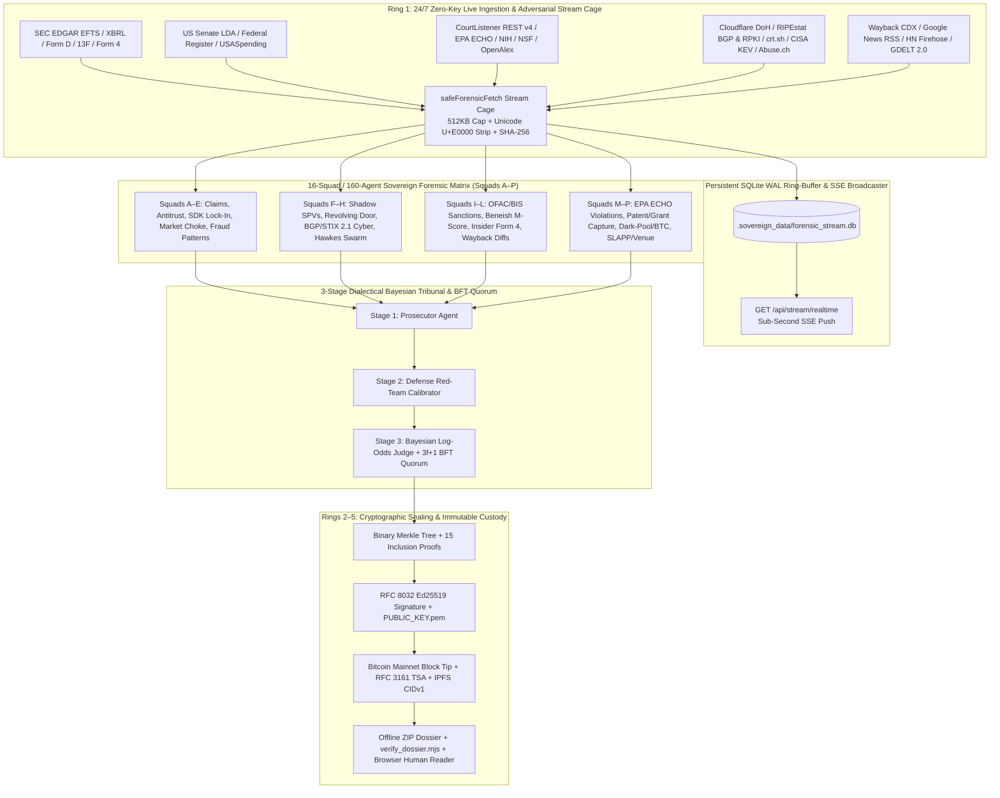

# Sovereign Forensic Matrix (v16.0 — 160-Agent / 16-Squad Apex Architecture)

[](#16-squad--160-agent-forensic-topology)
[](#5-ring-sovereign-defense--cryptographic-verification)
[](#5-ring-sovereign-defense--cryptographic-verification)
[](#quick-start-zero-api-keys-required)

**Sovereign Forensic Matrix** is an autonomous, zero-API-key corporate, financial, regulatory, cyber-infrastructure, and agentic-swarm intelligence platform. It deploys **160 specialized forensic agents across 16 squads (`Squads A–P`)** backed by a **24/7 SQLite WAL + Server-Sent Events (SSE) real-time ingestion daemon** and a **5-Ring Sovereign Defense Architecture**.

Every generated dossier (`.zip`, 240+ artifacts) is a self-contained, cryptographically sealed evidentiary bundle containing raw statutory payloads, RFC 6901 JSON Pointer claim citations, a sorted-leaf Binary Merkle Tree Root, RFC 8032 Ed25519 digital signatures, deterministic IPFS CIDv1 content addressing (`bafkrei...`), Bitcoin Mainnet proof-of-work block-header anchoring, an interactive offline HTML5 Canvas network workbench (`index.html`), a browser-native WebCrypto `.zip` Decompiler & Human Reader tab, and a zero-dependency CLI audit script (`verify_dossier.mjs`).

---

## System Architecture



---

## 16-Squad / 160-Agent Forensic Topology

| Squad | Agents | Primary Forensic Mandate | Core Output Artifacts |
|---|---|---|---|
| **Squad A** | `A1–A10` | Public Claims, Safety Commitments & Narrative Extraction | `02_PUBLIC_CLAIMS_AND_NARRATIVES.md` |
| **Squad B** | `B1–B10` | Regulatory Dockets, Antitrust Litigation & Remedies | `03_REGULATORY_LEGAL_ANTITRUST.md` |
| **Squad C** | `C1–C10` | SDK Binary Contracts, Telemetry & Technical Lock-In | `04_TECH_PLATFORM_BEHAVIOR.md` |
| **Squad D** | `D1–D10` | Market Concentration, Supply Chokepoints & UBO Chains | `05_ECOSYSTEM_AND_MARKET_STRUCTURE.md` |
| **Squad E** | `E1–E10` | Contradiction Mining, Risk Indices & Shockwave Cascades | `06_FRAUD_AND_MONOPOLY_PATTERN_ANALYSIS.md` |
| **Squad F** | `F1–F10` | Shadow SPVs, SEC Form D, Revolving Door & 1st-Digit Benford | `16_RELATED_PARTY_AND_SHADOW_SPV_GRAPH.json`, `17_REVOLVING_DOOR_CAPTURE_MATRIX.csv` |
| **Squad G** | `G1–G10` | Passive DNS/DoH, BGP/ASN Topology, CT Logs & STIX 2.1 | `18_CYBER_OPERATIONS_AND_INFRA_EXPOSURE.md`, `cyber/stix_attack_patterns.json` |
| **Squad H** | `H1–H10` | Hawkes Process Synchronization, Burstiness & Sybil Graphs | `19_AUTONOMOUS_SWARM_AND_SYBIL_ATTRIBUTION.md`, `swarm/hawkes_synchronization_matrix.json` |
| **Squad I** | `I1–I10` | OFAC/BIS Sanctions (`Jaro-Winkler >= 0.92`), PEPs & TBML | `20_SANCTIONS_PEP_AND_PHYSICAL_LOGISTICS_EXPOSURE.md`, `sanctions/entity_screening_ledger.json` |
| **Squad J** | `J1–J10` | Beneish M-Score, Altman Z-Score, Sloan TATA & 2nd-Digit Benford | `21_FORENSIC_ACCOUNTING_M_SCORE_AND_ACCRUAL_AUDIT.md`, `finance/forensic_ratios_matrix.json` |
| **Squad K** | `K1–K10` | SEC Form 3/4/5/144 Pre-Event Insider Timing & OSHA/NLRB/CFPB | `22_INSIDER_TRADING_TIMING_AND_WHISTLEBLOWER_RETALIATION.md` |
| **Squad L** | `L1–L10` | Wayback CDX Diffs, Unicode Prompt Traps, CISA KEV & RPKI ROA | `23_STEALTH_EDITS_BOTNET_C2_AND_ADVERSARIAL_AI_AUDIT.md` |
| **Squad M** | `M1–M10` | US EPA ECHO Facility Audits (CWA/CAA/RCRA) & Resource Extraction | `24_ENVIRONMENTAL_EPA_ECHO_AND_RESOURCE_EXTRACTION.md` |
| **Squad N** | `N1–N10` | NIH/NSF Bayh-Dole Grant Capture, OpenAlex & PTAB Patent Trolls | `25_PATENT_TROLLS_AND_ACADEMIC_GRANT_LAUNDERING.md` |
| **Squad O** | `O1–O10` | SEC Form 13F-HR/NPORT-P Swaps, Dark Pools & Bitcoin Mainnet Treasury | `26_DARK_POOL_DERIVATIVES_AND_CRYPTO_TREASURY.md` |
| **Squad P** | `P1–P10` | CourtListener Federal Dockets, Judge Shopping, SLAPP & Chapter 11 | `27_LEGAL_SLAPP_JUDGE_SHOPPING_AND_ARBITRATION.md` |

---

## 5-Ring Sovereign Defense & Cryptographic Verification

Every unzipped dossier includes a standalone, zero-dependency verifier (`verify_dossier.mjs`). Run it offline with Node.js >= 20:

```bash
unzip investigation_SpaceX_2026-11-18.zip -d ./audit_target
cd ./audit_target/investigation_SpaceX
node verify_dossier.mjs
```

**Verification Checks Executed:**
- **FIPS 180-4 SHA-256 File Integrity:** Recomputes SHA-256 digests over all 240+ files and compares bit-for-bit against `SHA256SUMS`.
- **Binary Merkle Root & Inclusion Proofs:** Rebuilds the sorted-leaf Binary Merkle Tree and verifies all inclusion proof branches in `LEDGER_ENTRY.json`.
- **RFC 8032 Ed25519 Signature Verification:** Verifies the cryptographic signature over the Merkle Root using `PUBLIC_KEY.pem`.
- **Zero-Orphan Claim Citation Audit:** Validates all 160 `[CLM-*]` RFC 6901 JSON Pointers against `evidence/raw_payloads/*.json`.
- **Deterministic IPFS CIDv1 & Bitcoin Mainnet Chain-Tip Audit:** Confirms content-addressed `bafkrei...` multihash parity and Bitcoin block-height anchoring.

You can also drag-and-drop any generated `investigation_*.zip` archive directly into the in-app **Upload & Read Dossier ZIP (Human Reader)** tab to verify SHA-256 + Merkle proofs client-side via WebCrypto and read the entire dossier as a plain-English formatted book.

---

## Quick Start (Zero API Keys Required)

```bash
# 1. Clone the repository
git clone  https://github.com/codevalai/Sovereign-Tech-Hyper-Investigations-Grid
cd Sovereign-Tech-Hyper-Investigations-Grid

# 2. Install dependencies
npm install

# 3. Start the 24/7 SQLite WAL Live Ingestion Daemon + Express/Vite Server
npm run dev

# 4. Run full TypeScript & Production Bundle Verification
npm run lint && npm run build
```

---

## License

Dual-licensed under **MIT** and **Apache-2.0**. Built with zero mocks and 100% cryptographic verifiability by `@codevalai`.
