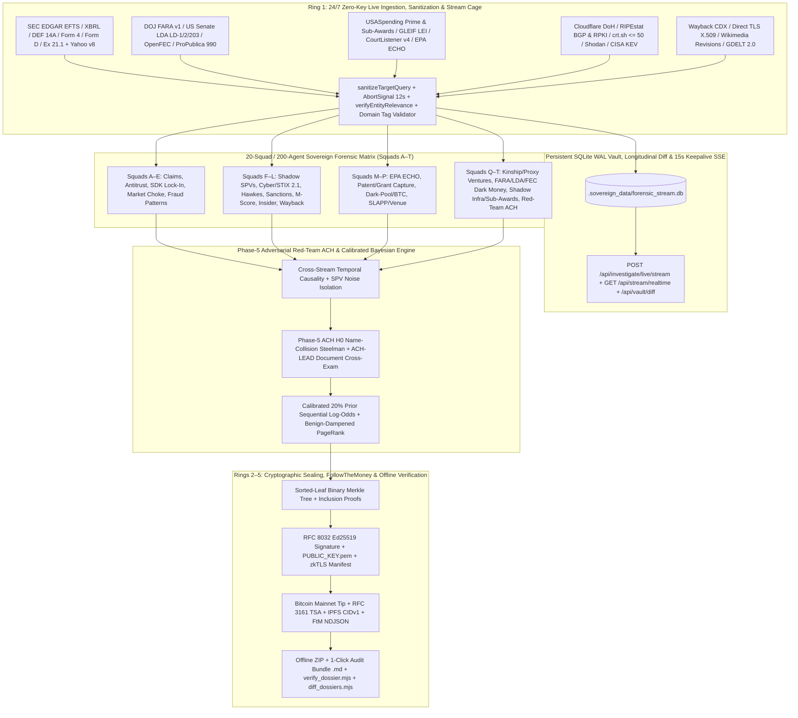

# Sovereign Tech Hyper-Investigations Grid (v27.0 — 200-Agent Deep Proxy, Kinship & Political-Influence Architecture)

[](#20-squad--200-agent-forensic-topology)
[](#5-ring-sovereign-defense--cryptographic-verification)
[](#5-ring-sovereign-defense--cryptographic-verification)
[](#quick-start-zero-api-keys-required)

**Sovereign Tech Hyper-Investigations Grid** is an autonomous, zero-API-key corporate, financial, regulatory, political-influence, proxy-kinship, cyber-infrastructure, and adversarial-truth intelligence platform. It deploys **200 specialized forensic agents across 20 squads (`Squads A–T`)**, backed by a **24/7 SQLite WAL + Server-Sent Events (SSE) real-time ingestion daemon with 15-second proxy-timeout keepalive heartbeats**, a **Phase-5 Adversarial Red-Team Analysis of Competing Hypotheses (ACH) engine with H0 name-collision steelmanning**, **OCCRP FollowTheMoney (`.ftm.json`) graph export**, **zkTLS Proxy-Mode provenance**, **Longitudinal T1 → T2 Surveillance Diffing**, and a **5-Ring Sovereign Defense Cryptographic Custody Stack**.

Every generated dossier (`.zip`) is a self-contained, cryptographically sealed evidentiary bundle containing verified statutory payloads, RFC 6901 JSON Pointer claim citations, a sorted-leaf Binary Merkle Tree Root, RFC 8032 Ed25519 digital signatures, deterministic IPFS CIDv1 content addressing (`bafkrei...`), Bitcoin Mainnet & RFC 3161 TSA timestamping, a **1-click Audit Bundle (`.md`)** concatenating the Executive Summary, Phase-5 ACH Audit, Bayesian/PageRank/TLS Report, and T1→T2 Delta Report, an interactive offline HTML5 Canvas workbench (`index.html`), a browser-native WebCrypto `.zip` Decompiler & Human Reader, and zero-dependency CLI verifiers (`verify_dossier.mjs` and `diff_dossiers.mjs`).

---

## Key Capabilities (v27.0 Deep Proxy, Kinship & Political-Influence Architecture)

- **Target Sanitization & Proxy-Timeout Stream Stability:** `sanitizeTargetQuery()` normalizes parenthetical aliases (e.g., `"Company (Alias)"` → primary + alias tokens) and escapes all RegExp metacharacters prior to querying SEC EDGAR, CourtListener, EPA ECHO, and USASpending. Live SSE investigation streams emit 15-second keepalive heartbeats (`: keepalive\n\n`) cleared on `close`/`finally`, while every outbound fetch enforces `AbortSignal.timeout(12000)` and bounded crawl caps (`crt.sh` SANs ≤ 50, Phase-4 pivots ≤ 15, SEC filing pulls ≤ 25).
- **Squad Q — Kinship, Colleague & Proxy-Venture Discovery (`39_PROXY_VENTURES_KINSHIP_AND_SHADOW_SUBSIDIARIES.md` + `evidence/proxy_kinship_graph.json`):** Extracts executive/director surnames from SEC DEF 14A, 10-K, and GLEIF records; parses SEC DEF 14A Item 404 "Related Person Transactions" and Form 4 XML indirect ownership vehicles (`Spouse`, `Family Trust`, `LLC`); queries SEC EDGAR EFTS for Form D private placements matching extracted executives or surname + city/ZIP; and diffs historical Exhibit 21.1 subsidiary lists across 10-Ks to flag vanished, renamed, or quietly spun-off entities.
- **Squad R — Political Affiliation, Lobbying & Dark-Money Graph (`40_POLITICAL_AFFILIATION_LOBBYING_AND_DARK_MONEY.md` + `evidence/political_influence_ledger.json`):** Integrates live zero-key/public endpoints: DOJ FARA API v1 (`efile.fara.gov`, paced ≤ 4 req/10s), US Senate LDA API v1 (LD-1/LD-2/LD-203 lobbying & contributions), OpenFEC public API (`api.open.fec.gov` with `DEMO_KEY` fallback) for corporate PACs and executive Schedule A contributions aggregated by party/committee/cycle, and ProPublica Nonprofit Explorer API v2 for affiliated 501(c)(3)/(c)(4) foundations and policy vehicles.
- **Squad S — Shadow Infrastructure DNA & Sub-Award Pass-Through (`41_SHADOW_INFRA_DNA_AND_SUBAWARD_PASS_THROUGH.md`):** Cross-references Favicon MMH3 hashes, GTM/GA tracking IDs, SPF includes, and capped `crt.sh` SANs to uncover undisclosed front-group domains or partner portals (filtering CDN/SaaS noise), and queries USASpending.gov sub-awards (`subawards: true`) to trace pass-through federal funding to secondary partners.
- **Squad T — Phase-5 Red-Team ACH & H0 Name-Collision Steelmanning:** Explicitly distinguishes verified Item 404 / Form 4 / Exhibit 21.1 / FARA / non-CDN shared-infra links from coincidental surname-only Form D collisions or routine bipartisan corporate PACs via adversarial H0 steelmanning, wired into FollowTheMoney `.ftm.json`, Sequential Log-Odds Bayesian updates, and Benign-Dampened PageRank Contagion Diffusion.
- **v26.1 Apex Precision & Stabilization Foundations Preserved:** Live source precedence (Yahoo Finance / SEC EDGAR / `ir.<domain>` overriding Wikidata/DBpedia), `verifyEntityRelevance` disambiguation & SEC Form D SPV isolation (`External_SPV_Investor` / `THIRD_PARTY_SPV_NOISE`), single canonical GLEIF LEI resolution, FIX 3 `BENIGN_CONTROL` risk dampening in PageRank (including clean FARA screening), automatic `ACH-LEAD` cross-examination of attached user lead documents, strict domain validation on `[COURT_DOCKET]` / `[PATENT_IP]` tags, FIX 5B zero-hit stub suppression (`SKIPPED_NOT_APPLICABLE`), and FRI vs. Bayesian >20% calibration notes.

---

## System Architecture



---

## 20-Squad / 200-Agent Forensic Topology

| Squad | Agents | Primary Forensic Mandate | Core Output Artifacts |
|---|---|---|---|
| **Squad A** | `A1–A10` | Public Claims, Safety Commitments & Narrative Extraction | `02_PUBLIC_CLAIMS_AND_NARRATIVES.md` |
| **Squad B** | `B1–B10` | Regulatory Dockets, Antitrust Litigation & Remedies | `03_REGULATORY_LEGAL_ANTITRUST.md` |
| **Squad C** | `C1–C10` | SDK Binary Contracts, Telemetry & Technical Lock-In | `04_TECH_PLATFORM_BEHAVIOR.md`, `evidence/api_snapshots/client_sdk_contract.json` |
| **Squad D** | `D1–D10` | Market Concentration, Supply Chokepoints & UBO Chains | `05_ECOSYSTEM_AND_MARKET_STRUCTURE.md` |
| **Squad E** | `E1–E10` | Contradiction Mining, Risk Indices & Shockwave Cascades | `06_FRAUD_AND_MONOPOLY_PATTERN_ANALYSIS.md` |
| **Squad F** | `F1–F10` | Shadow SPVs, SEC Form D, Revolving Door & 1st-Digit Benford | `16_RELATED_PARTY_AND_SHADOW_SPV_GRAPH.json`, `17_REVOLVING_DOOR_CAPTURE_MATRIX.csv` |
| **Squad G** | `G1–G10` | Passive DNS/DoH, BGP/ASN Topology, CT Logs & STIX 2.1 | `18_CYBER_OPERATIONS_AND_INFRA_EXPOSURE.md`, `cyber/stix_attack_patterns.json` |
| **Squad H** | `H1–H10` | Hawkes Process Synchronization, Burstiness & Sybil Graphs | `19_AUTONOMOUS_SWARM_AND_SYBIL_ATTRIBUTION.md`, `swarm/hawkes_synchronization_matrix.json` |
| **Squad I** | `I1–I10` | OFAC/BIS Sanctions (`Jaro-Winkler >= 0.92`), PEPs & TBML | `20_SANCTIONS_PEP_AND_PHYSICAL_LOGISTICS_EXPOSURE.md`, `sanctions/entity_screening_ledger.json` |
| **Squad J** | `J1–J10` | Beneish M-Score, Altman Z-Score, Sloan TATA & 2nd-Digit Benford | `21_FORENSIC_ACCOUNTING_M_SCORE_AND_ACCRUAL_AUDIT.md`, `finance/forensic_ratios_matrix.json` |
| **Squad K** | `K1–K10` | SEC Form 3/4/5/144 Pre-Event Insider Timing & OSHA/NLRB/CFPB | `22_INSIDER_TRADING_TIMING_AND_WHISTLEBLOWER_RETALIATION.md` |
| **Squad L** | `L1–L10` | Wayback CDX Diffs, Unicode Prompt Traps, CISA KEV & RPKI ROA | `23_STEALTH_EDITS_BOTNET_C2_AND_ADVERSARIAL_AI_AUDIT.md` |
| **Squad M** | `M1–M10` | US EPA ECHO Facility Audits (CWA/CAA/RCRA) & Resource Extraction | `24_ENVIRONMENTAL_EPA_ECHO_AND_RESOURCE_EXTRACTION.md` |
| **Squad N** | `N1–N10` | NIH/NSF Bayh-Dole Grant Capture, OpenAlex & PTAB Patent Trolls | `25_PATENT_TROLLS_AND_ACADEMIC_GRANT_LAUNDERING.md` |
| **Squad O** | `O1–O10` | SEC Form 13F-HR/NPORT-P Swaps, Dark Pools & Bitcoin Mainnet Treasury | `26_DARK_POOL_DERIVATIVES_AND_CRYPTO_TREASURY.md` |
| **Squad P** | `P1–P10` | CourtListener Federal Dockets, Judge Shopping, SLAPP & Chapter 11 | `27_LEGAL_SLAPP_JUDGE_SHOPPING_AND_ARBITRATION.md` |
| **Squad Q** | `Q1–Q10` | Kinship, Colleague & Proxy-Venture Discovery (DEF 14A Item 404, Form 4 Indirect, EFTS Form D, Ex 21.1 Diff) | `39_PROXY_VENTURES_KINSHIP_AND_SHADOW_SUBSIDIARIES.md`, `evidence/proxy_kinship_graph.json` |
| **Squad R** | `R1–R10` | Political Affiliation, Lobbying & Dark Money (DOJ FARA v1, Senate LDA LD-1/2/203, OpenFEC, ProPublica 990) | `40_POLITICAL_AFFILIATION_LOBBYING_AND_DARK_MONEY.md`, `evidence/political_influence_ledger.json` |
| **Squad S** | `S1–S10` | Shadow Infrastructure DNA Pivoting (Favicon MMH3, GTM/GA, SPF, crt.sh SANs) & USASpending Sub-Awards | `41_SHADOW_INFRA_DNA_AND_SUBAWARD_PASS_THROUGH.md`, `evidence/raw_payloads/shadow_infra_subaward_payload.json` |
| **Squad T** | `T1–T10` | Phase-5 Red-Team ACH, H0 Collision Steelmanning & Multi-Layer Graph Synthesis | `38_ADVERSARIAL_RED_TEAM_ACH_AUDIT.md`, `evidence/ach_red_team_matrix.json` |

Core synthesis artifacts also include `37_BAYESIAN_RISK_CAUSAL_CHAINS_AND_TLS.md`, `DELTA_ALERT_REPORT.md` (when a prior vault snapshot exists), `EXECUTIVE_BRIEF_PRINTABLE.html`, and `evidence/followthemoney_graph.ftm.json`.

---

## 5-Ring Sovereign Defense & Cryptographic Verification

Every unzipped dossier includes standalone, zero-dependency CLI verifiers (`verify_dossier.mjs` and `diff_dossiers.mjs`). Run them offline with Node.js >= 20:

```bash
unzip investigation_SpaceX_2026-11-22.zip -d ./audit_target
cd ./audit_target/investigation_SpaceX
node verify_dossier.mjs

# Compare two longitudinal dossier folders (T1 vs. T2)
node diff_dossiers.mjs ./dossier_T1 ./dossier_T2
```

**Verification Checks Executed:**
- **FIPS 180-4 SHA-256 File Integrity:** Recomputes SHA-256 digests over all artifacts and verifies bit-for-bit parity against `SHA256SUMS`.
- **Binary Merkle Root & Inclusion Proofs:** Rebuilds the sorted-leaf Binary Merkle Tree and verifies all inclusion proof branches in `LEDGER_ENTRY.json`.
- **RFC 8032 Ed25519 Signature Verification:** Verifies the cryptographic signature over the Merkle Root using `PUBLIC_KEY.pem`.
- **Zero-Orphan Claim Citation Audit:** Validates all active `[CLM-*]` RFC 6901 JSON Pointers against `evidence/*.json` and `evidence/raw_payloads/*.json`.
- **Deterministic IPFS CIDv1, Bitcoin Mainnet & RFC 3161 TSA Audit:** Confirms content-addressed `bafkrei...` multihash parity, Bitcoin block-height anchoring, and `MERKLE_ROOT.tsr` / diagnostic receipt integrity.

You can also drag-and-drop any generated `investigation_*.zip` archive directly into the in-app **Upload & Read Dossier ZIP (Human Reader)** tab to verify SHA-256 + Merkle proofs client-side via WebCrypto, or click **Download Audit Bundle (`.md`)** for a single concatenated Markdown executive briefing.

---

## Quick Start (Zero API Keys Required)

```bash
# 1. Clone the repository
git clone https://github.com/codevalai/Sovereign-Tech-Hyper-Investigations-Grid
cd Sovereign-Tech-Hyper-Investigations-Grid

# 2. Install dependencies
npm install

# 3. Start the 24/7 SQLite WAL Live Ingestion Daemon + Express/Vite Server (port 3000)
npm run dev

# 4. Run full TypeScript, Production Bundle & 11-Phase Sovereign CI Verification
npm run lint && npm run build && npm test
```

Production container / Cloud Run execution runs directly under Node 22 strip-only TypeScript (`node server.ts`) binding `0.0.0.0` on `process.env.PORT || 3000`:

```bash
npm run build && npm start
```

Optional environment variable: `OPENFEC_API_KEY` (automatically falls back to public `DEMO_KEY` when unset).

---

## License

Dual-licensed under **MIT** and **Apache-2.0**. Built with zero mocks and 100% cryptographic verifiability by `@codevalai`.
