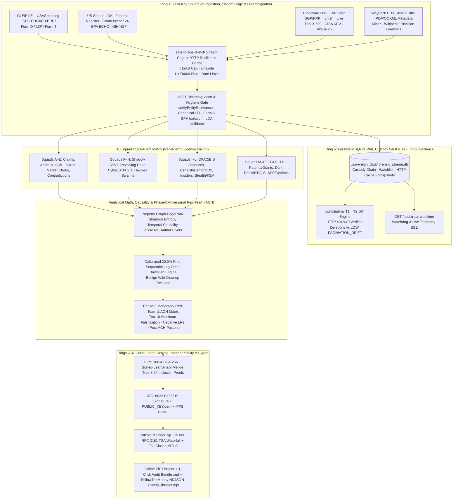

# Sovereign Tech Hyper-Investigations Grid (v26.1 — Apex Precision)

[](#what-is-new-in-v261-apex-precision)
[](#16-squad--160-agent-forensic-topology)
[](#cryptographic-provenance--offline-verification)
[](#cryptographic-provenance--offline-verification)
[](#court-grade-dossier-artifacts)
[](#quick-start-zero-api-keys-required)

**Sovereign Tech Hyper-Investigations Grid** is a zero-API-key, court-grade corporate, financial, regulatory, cyber-infrastructure, and adversarial-intelligence platform. It orchestrates **160 specialist forensic agents across 16 squads (`Squads A–P`)** backed by live sovereign registry probes, a **24/7 SQLite WAL custody vault & SSE real-time daemon**, a **calibrated Sequential Log-Odds Bayesian & Phase-5 Adversarial Red-Team (ACH) falsification engine**, and a **5-Ring Sovereign Defense Architecture**.

Every completed investigation outputs both a **1-Click Executive Audit Bundle (`.md`)** and a cryptographically sealed **Offline Evidentiary Dossier (`.zip`, 260+ artifacts)** containing raw statutory payloads, RFC 6901 JSON Pointer citations (0 orphaned claims), a sorted-leaf Binary Merkle Root with 24 inclusion proofs, RFC 8032 Ed25519 signatures, deterministic IPFS CIDv1 addressing (`bafkrei...`), Bitcoin Mainnet block-header anchoring, 3-tier RFC 3161 TSA timestamp receipts, fail-closed TLSNotary zkTLS provenance manifests, OCCRP FollowTheMoney NDJSON entity graphs, STIX 2.1 cyber bundles, printable executive briefs, an interactive offline workbench, and zero-dependency CLI verifiers (`verify_dossier.mjs` & `diff_dossiers.mjs`).

---

## What Is New in v26.1 (Apex Precision)

v26.1 (**Forensic Disambiguation & Calibrated Truth**) hardens every ingestion, entity-resolution, scoring, and longitudinal-diff pipeline against real-world OSINT noise:

1. **Strict Entity Disambiguation Gate (`verifyEntityRelevance`)** — Deterministic relevance filtering before ingesting hits from OpenStreetMap (Nominatim/Photon), UK Companies House, ProPublica 990 nonprofits, and npm/PyPI/crates.io/Docker Hub registries. Rejects conflicting POI categories (e.g., `arts_centre`, `gallery`, `cafe`, `shop` on aerospace/tech targets) and unverified name collisions unless legal name plus jurisdiction, SIC/industry, or verified website/GitHub domain corroborate the target.
2. **SEC Form D SPV / Fund Director Isolation** — Parses `<primaryIssuer><entityName>` in SEC Form D `primary_doc.xml` filings; officers and directors of third-party investment vehicles (`LP`, `L.P.`, `Fund`, `Capital`, `Ventures`, `Partners`, `Holdings`, `SPV`, `Trust`, `Series`) are strictly classified as `External_SPV_Investor` in `externalSpvInvestors` and isolated FollowTheMoney `Ownership` (`Investor`) edges—never merged into the target's `Key Executives` or direct `Directorship`.
3. **Single Canonical GLEIF LEI Resolution** — `resolveCanonicalGleifLei()` prefers live GLEIF API exact legal-name matches over Wikidata/DBpedia fallbacks and enforces the exact same canonical LEI across `00_EXEC_SUMMARY.md`, `artifact-index.json` (`canonical_gleif_lei`), `evidence/followthemoney_graph.ftm.json`, and `08_SOURCE_INDEX.csv`.
4. **Senate LDA Lobbying Parser Hygiene & Clean PageRank** — Strictly validates every U.S. Senate LDA record via `isValidSenateLdaRecord()`, eliminating synthetic web-fallback stubs and raw domain/URL registrants (`$0` domain nodes) so Property Graph Top-10 PageRank reflects real infrastructure, corporate, and regulatory chokepoints.
5. **Calibrated `20.0%` Bayesian Prior & Wikipedia Sourcing-Cleanup Filter** — Decouples the Sequential Log-Odds prior from FRI and anchors it at a calibrated **`0.20` (`20.0%`)** enterprise base rate. Large Wikipedia deletions (`Δ <= -1500B`) whose revision comments match citation/dead-ref/sourcing/SEC-filing/trade-press/revert cleanup criteria are classified as `BENIGN_SOURCING_CLEANUP` and excluded from `WHITEWASH_RISK`, Temporal Causality, Bayesian penalties, and Phase-5 ACH.
6. **Zero-Jitter T1 vs. T2 Longitudinal Diffing** — In `longitudinalDiffEngine.ts`, `diff_dossiers.mjs`, and `/api/vault/diff`, missing URLs are classified as `SILENT_DELETION` / `ARTIFACT_DISAPPEARED` **only** when hosted on the target's own primary/subsidiary domain **and** confirmed HTTP `404`/`410` via live `HEAD`/`GET`. Search/Wayback pagination shifts emit `LOW` `PAGINATION_DRIFT` (`STRUCTURAL_CHANGE`, 0 Bayesian impact).

---

## System Architecture



---

## 16-Squad / 160-Agent Forensic Topology

Every squad runs strict **per-agent evidence slicing** (`src/engine/sparseSquadCompressor.ts`): hit-bearing specialists expand with non-duplicated evidentiary tables, zero-hit specialists fail closed into cryptographic `ATTESTATION [ZERO_HIT]` receipts, and squad compilers (`*_10_*`) synthesize only corroborated specialist findings.

| Squad | Agents | Primary Forensic Mandate | Core Output Artifacts |
|---|---|---|---|
| **Squad A** | `A1–A10` | Public Claims, Safety Commitments & Narrative Extraction | `02_PUBLIC_CLAIMS_AND_NARRATIVES.md` |
| **Squad B** | `B1–B10` | Regulatory Dockets, Antitrust Litigation & Remedies | `03_REGULATORY_LEGAL_ANTITRUST.md` |
| **Squad C** | `C1–C10` | SDK Binary Contracts, Telemetry & Technical Lock-In | `04_TECH_PLATFORM_BEHAVIOR.md` |
| **Squad D** | `D1–D10` | Market Concentration, Supply Chokepoints & UBO Chains | `05_ECOSYSTEM_AND_MARKET_STRUCTURE.md` |
| **Squad E** | `E1–E10` | Contradiction Mining, Risk Indices & Shockwave Cascades | `06_FRAUD_AND_MONOPOLY_PATTERN_ANALYSIS.md` |
| **Squad F** | `F1–F10` | Shadow SPVs, SEC Form D Isolation, Senate LDA & Benford D1 | `16_RELATED_PARTY_AND_SHADOW_SPV_GRAPH.json`, `17_REVOLVING_DOOR_CAPTURE_MATRIX.csv` |
| **Squad G** | `G1–G10` | Passive DoH, BGP/ASN Topology, CT Logs, TLS X.509 & STIX 2.1 | `18_CYBER_OPERATIONS_AND_INFRA_EXPOSURE.md`, `cyber/stix_attack_patterns.json` |
| **Squad H** | `H1–H10` | Hawkes Process Synchronization, Burstiness & Sybil Graphs | `19_AUTONOMOUS_SWARM_AND_SYBIL_ATTRIBUTION.md`, `swarm/hawkes_synchronization_matrix.json` |
| **Squad I** | `I1–I10` | OFAC/BIS Sanctions (`Jaro-Winkler >= 0.92`), PEPs & TBML | `20_SANCTIONS_PEP_AND_PHYSICAL_LOGISTICS_EXPOSURE.md`, `sanctions/entity_screening_ledger.json` |
| **Squad J** | `J1–J10` | Beneish M-Score, Altman Z-Score, Sloan TATA, DSRI & Benford D2 | `21_FORENSIC_ACCOUNTING_M_SCORE_AND_ACCRUAL_AUDIT.md`, `finance/forensic_ratios_matrix.json` |
| **Squad K** | `K1–K10` | SEC Form 3/4/5/144 Pre-Event Insider Timing & OSHA/NLRB/CFPB | `22_INSIDER_TRADING_TIMING_AND_WHISTLEBLOWER_RETALIATION.md` |
| **Squad L** | `L1–L10` | Wayback CDX Stealth Diffs, Unicode Prompt Traps, CISA KEV & RPKI | `23_STEALTH_EDITS_BOTNET_C2_AND_ADVERSARIAL_AI_AUDIT.md` |
| **Squad M** | `M1–M10` | US EPA ECHO Facility Audits (CWA/CAA/RCRA) & Extraction | `24_ENVIRONMENTAL_EPA_ECHO_AND_RESOURCE_EXTRACTION.md` |
| **Squad N** | `N1–N10` | NIH/NSF Bayh-Dole Grant Capture, OpenAlex & PTAB Patents | `25_PATENT_TROLLS_AND_ACADEMIC_GRANT_LAUNDERING.md` |
| **Squad O** | `O1–O10` | SEC Form 13F-HR/NPORT-P Swaps, Dark Pools & BTC Treasury | `26_DARK_POOL_DERIVATIVES_AND_CRYPTO_TREASURY.md` |
| **Squad P** | `P1–P10` | CourtListener Federal Dockets, Judge Shopping, SLAPP & Ch. 11 | `27_LEGAL_SLAPP_JUDGE_SHOPPING_AND_ARBITRATION.md` |

---

## Court-Grade Dossier Artifacts

Each investigation generates **260+ cryptographically sealed artifacts** plus a **1-Click Audit Bundle (`.md`)**:

| Artifact Path | Purpose |
|---|---|
| `00_EXEC_SUMMARY.md` | Executive brief with canonical GLEIF LEI, isolated External SPV Investors, key executives, FRI/MAI & Bayesian scores |
| `08_SOURCE_INDEX.csv` | Deduplicated statutory & web source registry aligned to the canonical GLEIF LEI |
| `12_SUBSIDIARIES_SUBSIDIES_ACQUIRED_AND_SOLD.md` | GLEIF LEI corporate tree, USASpending federal awards, SEC Form D offerings & M&A ledger |
| `35_DEEP_ARTIFACT_METADATA_AND_INFRA_DNA.md` | Mined PDF/OOXML metadata, Favicon MMH3, Author-to-Entity `HIGH_SIGNAL_METADATA_PIVOT` findings |
| `37_BAYESIAN_RISK_CAUSAL_CHAINS_AND_TLS.md` | Calibrated `20.0%` prior Bayesian log-odds trace, Top-10 PageRank, Shannon entropy, multi-hop causal chains, TLS X.509 & Wikipedia Revision Forensics |
| `38_ADVERSARIAL_RED_TEAM_ACH_AUDIT.md` | Phase-5 Analysis of Competing Hypotheses (ACH) matrix steelmanning the top adverse findings with negative LRs |
| `DELTA_ALERT_REPORT.md` | Longitudinal T1 vs. T2 surveillance alert report distinguishing verified `SILENT_DELETION` from `LOW PAGINATION_DRIFT` |
| `EXECUTIVE_BRIEF_PRINTABLE.html` | Self-contained, print/PDF-ready executive intelligence brief with `SURVIVED ADVERSARIAL RED-TEAM` badges |
| `evidence/followthemoney_graph.ftm.json` | OCCRP Aleph-compatible FollowTheMoney NDJSON entity & relationship graph (including isolated SPV `Investor` edges) |
| `evidence/ach_red_team_matrix.json` | Machine-readable Phase-5 ACH diagnosticity matrix & pre/post Red-Team posterior adjustments |
| `evidence/bayesian_and_graph_analytics.json` | Complete Bayesian posterior, PageRank top nodes, Shannon entropy, causal chains, and longitudinal snapshot |
| `evidence/zktls_proofs/zktls_provenance_manifest.json` | Fail-closed TLSNotary Proxy-Mode web proof manifest (`LOCAL_HASH_ONLY` when sidecar offline; never fabricated) |
| `LEDGER_ENTRY.json`, `SHA256SUMS`, `PUBLIC_KEY.pem`, `artifact-index.json` | Cryptographic custody seal (Merkle root, 24 inclusion proofs, Ed25519 signature, IPFS CIDv1, BTC tip, RFC 3161 status/TSR, canonical LEI) |
| `verify_dossier.mjs` & `diff_dossiers.mjs` | Zero-dependency Node.js offline cryptographic verifier and T1↔T2 longitudinal diff CLI |
| **1-Click Audit Bundle (`audit_bundle_<entity>.md`)** | UI button concatenating `00_EXEC_SUMMARY.md`, `38_ADVERSARIAL_RED_TEAM_ACH_AUDIT.md`, `37_BAYESIAN_RISK_CAUSAL_CHAINS_AND_TLS.md`, and `DELTA_ALERT_REPORT.md` |

---

## Cryptographic Provenance & Offline Verification

### 1. Verify Any Dossier ZIP Offline (Zero Dependencies, Node.js >= 20)

```bash
unzip investigation_SpaceX_2026-11-19.zip -d ./audit_target
cd ./audit_target/investigation_SpaceX
node verify_dossier.mjs
```

`verify_dossier.mjs` independently checks:
- **FIPS 180-4 SHA-256 Checksums** across all 260+ artifacts against `SHA256SUMS`
- **Sorted-Leaf Binary Merkle Root & 24 Inclusion Proofs** against `LEDGER_ENTRY.json`
- **RFC 8032 Ed25519 Signature** against `PUBLIC_KEY.pem`
- **Zero-Orphan Claim-to-Evidence Links** across `raw/*.md` and RFC 6901 JSON Pointers
- **Ring-3 IPFS CIDv1** deterministic multihash parity (`bafkrei...`)
- **Ring-2 Bitcoin Mainnet Block Tip** and **3-Tier RFC 3161 TSA** receipt (`MERKLE_ROOT.tsr` or `MERKLE_ROOT.tsr.status.json`)
- **zkTLS Provenance Manifest**, **FollowTheMoney NDJSON Schema Integrity**, and **Phase-5 ACH Matrix**

### 2. Diff Two Dossiers Longitudinally (T1 vs. T2)

```bash
node diff_dossiers.mjs ./dossier_T1 ./dossier_T2 \
  --out ./delta_diff.json \
  --md ./DELTA_ALERT_REPORT.md
```

Or drag-and-drop any `.zip` dossier into the in-app **Upload & Read Dossier ZIP (Human Reader)** tab for client-side WebCrypto SHA-256 + Merkle verification and plain-English reading.

---

## REST & SSE API Reference

All routes are served on port `3000` by `server.ts` (Express + Vite dev middleware in development, static `dist/` in production):

| Method | Endpoint | Description |
|---|---|---|
| `GET` | `/api/health` | Service health, SQLite WAL status, and runtime telemetry |
| `POST` | `/api/investigate/live` | Full zero-key live OSINT investigation (`{ query, geography, timeRange, focus, constraints }`) |
| `POST` | `/api/investigate/live/stream` | Live Server-Sent Events (SSE) streaming investigation progress & final intelligence payload |
| `POST` | `/api/investigate/spider` | Bounded autonomous multi-hop contagion spider |
| `POST` | `/api/anchor/finalize` | Asynchronous 3-tier RFC 3161 TSA waterfall (`freetsa.org`, `digicert`, `starfieldtech`) + Bitcoin Mainnet anchor |
| `GET` | `/api/stream/realtime` | 24/7 SQLite WAL custody watchdog & real-time forensic telemetry SSE stream |
| `GET` | `/api/stream/latest` | Latest ring-buffer ingestion snapshot |
| `GET` | `/api/vault/diff` | Longitudinal T1 vs. T2 vault diff with live HTTP `404`/`410` target-domain deletion verification |
| `POST` | `/api/vault/delta-check/:investigationId` | Re-probe a sealed investigation and emit an Ed25519-signed Living Dossier delta |
| `GET` | `/api/vault/search` | Full-text search across archived SQLite WAL investigations |
| `GET` | `/api/vault/apex-graph` | Cross-entity WebGPU/Canvas custody vault graph |
| `GET` / `POST` | `/api/watchlist` | Manage monitored corporate targets |
| `POST` | `/api/watchlist/scan` | Run live delta scan across watchlisted targets |
| `GET` / `POST` | `/api/investigations/archive` | Persist & retrieve cryptographically sealed dossiers in the SQLite WAL vault |
| `GET` | `/api/investigations/correlate` | Cross-investigation shared-entity, officer, and infrastructure correlation |

---

## Repository Structure

```text
.
├── server.ts                          # Express + Vite unified server (port 3000) & REST/SSE API
├── server/                            # Zero-key live OSINT & Ring-1/Ring-5 backend engines
│   ├── osintEngine.ts                 # Master live OSINT orchestrator (v26.1 disambiguation + canonical LEI)
│   ├── sovereignRegistries.ts         # GLEIF LEI, USASpending, SEC Form D primary_doc.xml SPV isolator
│   ├── deepLiveProbes.ts              # Senate LDA, XBRL CompanyFacts, TLS X.509, Wikipedia forensics, OSV/pkgs
│   ├── temporalCausalityEngine.ts     # Cross-stream Δt <= 14d causality, burstiness & multi-hop chains
│   ├── extremeDorkEngine.ts           # Wayback CDX stealth-edit differ & passive dork collector
│   ├── deepArtifactMiner.ts           # Wayback id_ PDF & OOXML binary metadata extractor
│   ├── infraDnaFingerprinter.ts       # Favicon MMH3, DNS/DoH, BGP/RPKI & CSP fingerprinting
│   ├── contagionSpider.ts             # Bounded multi-hop corporate/domain contagion spider
│   ├── recursiveDorkLoop.ts           # Closed-loop recursive dork mutator
│   ├── adversarialShield.ts           # Ring-1 512KB byte-capped fetch cage & Unicode U+E0000 sanitizer
│   ├── httpResilience.ts              # SQLite-backed HTTP cache, host rate-limiting & retry backoff
│   ├── blockchainAnchor.ts            # Bitcoin Mainnet chain-tip & RFC 3161 anchoring
│   └── liveIngestionDaemon.ts         # 24/7 SQLite WAL custody chain, watchlist & verified T1↔T2 diffing
├── src/
│   ├── engine/                        # Pure forensic intelligence & interoperability engines
│   │   ├── entityDisambiguation.ts    # v26.1 relevance gate, SPV classifier, canonical LEI, LDA & Wiki filters
│   │   ├── adversarialAchEngine.ts    # Phase-5 Red-Team & Analysis of Competing Hypotheses (ACH)
│   │   ├── longitudinalDiffEngine.ts  # T1↔T2 diffing + standalone diff_dossiers.mjs generator
│   │   ├── followTheMoneyExporter.ts  # OCCRP FollowTheMoney NDJSON graph exporter
│   │   ├── metadataPivotEngine.ts     # Author-to-Entity binary metadata pivot correlator
│   │   ├── sparseSquadCompressor.ts   # Per-agent evidence slicing & fail-closed ZERO_HIT receipts
│   │   ├── unknownFraudDetector.ts    # Modified Z-score, Benford D2 chi-sq & cycle detection
│   │   ├── entityResolution.ts        # Jaro-Winkler & corporate legal-name similarity
│   │   ├── livingDossierDelta.ts      # Ed25519-signed incremental dossier delta patches
│   │   ├── privateEntityDiscovery.ts  # Private-company footprint synthesizer
│   │   ├── recursivePivoter.ts        # Autonomous entity/domain pivot queue
│   │   └── subsidiaryAndSwarmMapper.ts# Subsidiary tree & orchestrated swarm mapper
│   ├── services/                      # Dossier assembly, math, Ed25519, swarm & ZIP packaging
│   │   ├── dossierGenerator.ts        # 260+ file sealed dossier, Merkle tree & verify_dossier.mjs emitter
│   │   ├── forensicMathEngine.ts      # SHA-256, Merkle, Bayesian (20% prior), PageRank, Hawkes, Benford, Entropy
│   │   ├── swarmOrchestrator.ts       # 16-squad / 160-agent topology & claim router
│   │   ├── zipService.ts              # ZIP packager (RFC 3161 receipts) & 1-Click Audit Bundle (.md)
│   │   ├── ed25519Engine.ts           # RFC 8032 Ed25519 keygen, signing & PEM export
│   │   ├── externalAnchor.ts          # 3-tier RFC 3161 DER builder & waterfall submitter
│   │   ├── workbenchTemplate.ts       # Offline HTML5 Canvas workbench & printable executive brief builder
│   │   └── liveInvestigationService.ts# Client-side SSE & REST investigation bridge
│   ├── forensics/                     # Accounting (Beneish/Altman/Sloan) & stealth probes
│   ├── crypto/ & provenance/          # Fail-closed TLSNotary zkTLS Proxy-Mode adapter
│   └── components/                    # React 19 + Tailwind CSS v4 forensic command interface
├── scripts/verify-ci.ts               # 11-phase cryptographic, mathematical & v26.1 precision CI suite
├── Dockerfile & docker-compose.yml    # Multi-stage Node 22 non-root production container
└── .github/workflows/sovereign-ci.yml # Automated GitHub Actions 11-phase CI + Docker build check
```

---

## Quick Start (Zero API Keys Required)

**Prerequisites:** Node.js `>= 22.0.0` (uses built-in `node:sqlite` WAL and WebCrypto/Ed25519).

```bash
# 1. Clone the repository
git clone cd https://github.com/codevalai/Sovereign-Tech-Hyper-Investigations-Grid

# 2. Install dependencies
npm install

# 3. Start the 24/7 SQLite WAL daemon + Express/Vite server on http://localhost:3000
npm run dev

# 4. Run full TypeScript check, production Vite build, and 11-phase Cryptographic CI
npm run ci
```

### Optional: Real TLSNotary Proxy-Mode zkTLS Sidecar

No API keys are required. To upgrade web provenance from `LOCAL_HASH_ONLY` to live mathematical HTTPS transcript proofs, point `.env` to a local TLSNotary Proxy-Mode prover/verifier sidecar:

```bash
cp .env.example .env
# Edit .env and set:
# TLSN_VERIFIER_URL="http://127.0.0.1:7047"
```

When unset or unreachable, the grid fails closed cleanly (`LOCAL_HASH_ONLY (TLSN_SIDECAR_OFFLINE)`) and never fabricates proofs.

### Production Docker Deployment

```bash
docker compose up --build -d
# Verify container health
curl -fsS http://127.0.0.1:3000/api/health
```

---

## 11-Phase Cryptographic & Forensic CI Suite

Run `npm run ci` (or `npx tsx scripts/verify-ci.ts --require-build`) to execute all 11 automated verification phases:

1. **Phase 1:** 160-Agent / 16-Squad dossier sealing, SHA-256 parity, Binary Merkle Root, 24 inclusion proofs, Ed25519 signature, 0 orphaned claims, IPFS CIDv1, zkTLS manifest, FollowTheMoney NDJSON & Phase-5 ACH.
2. **Phase 2:** Ring-1 adversarial stream cage (`512KB` cap, Unicode Tag `U+E0000` stripping) & Ring-3 IPFS CIDv1.
3. **Phase 3:** Ring-5 SQLite WAL custody chain & cross-entity correlation.
4. **Phase 4:** Entity resolution (`Jaro-Winkler`), recursive pivoter & Ed25519 Living Dossier delta patches.
5. **Phase 5:** Zero-day fraud detector (Modified Z-Score, Benford D2, cycle detection) & MITRE ATLAS swarm detection.
6. **Phase 6:** Binary artifact miner, Favicon MMH3 & red-team corroboration gate.
7. **Phase 7:** RFC 3161 DER encoding, HTTP resilience cache & cross-stream temporal causality (`Δt <= 14d`).
8. **Phase 8 / 8B:** Per-agent evidence slicing, Wayback `id_` PDF streaming, 3-tier RFC 3161 ZIP receipts, XBRL frame selection & OOXML bit-3 descriptor parsing.
9. **Phase 9:** Sequential Bayesian posterior, PageRank, Shannon entropy, multi-hop causal chains, TLS X.509, printable brief & watchlist search.
10. **Phase 10:** Server module export contract & Vite production bundle integrity.
11. **Phase 11 (11.1–11.6):** Sovereign registries (GLEIF/USASpending/Form D), metadata author pivots, fail-closed zkTLS, Phase-5 ACH, FollowTheMoney NDJSON, longitudinal `diff_dossiers.mjs` CLI, 1-Click Audit Bundle (`.md`), and **v26.1 Apex Precision** (entity disambiguation gate, Form D SPV isolation, single canonical GLEIF LEI parity, Senate LDA/PageRank hygiene, calibrated `20.0%` prior + Wikipedia sourcing-cleanup filter, and short-window diff jitter elimination).

---

## License

Dual-licensed under **MIT** and **Apache-2.0**. Built with zero mocks, zero required API keys, and 100% offline cryptographic verifiability.
