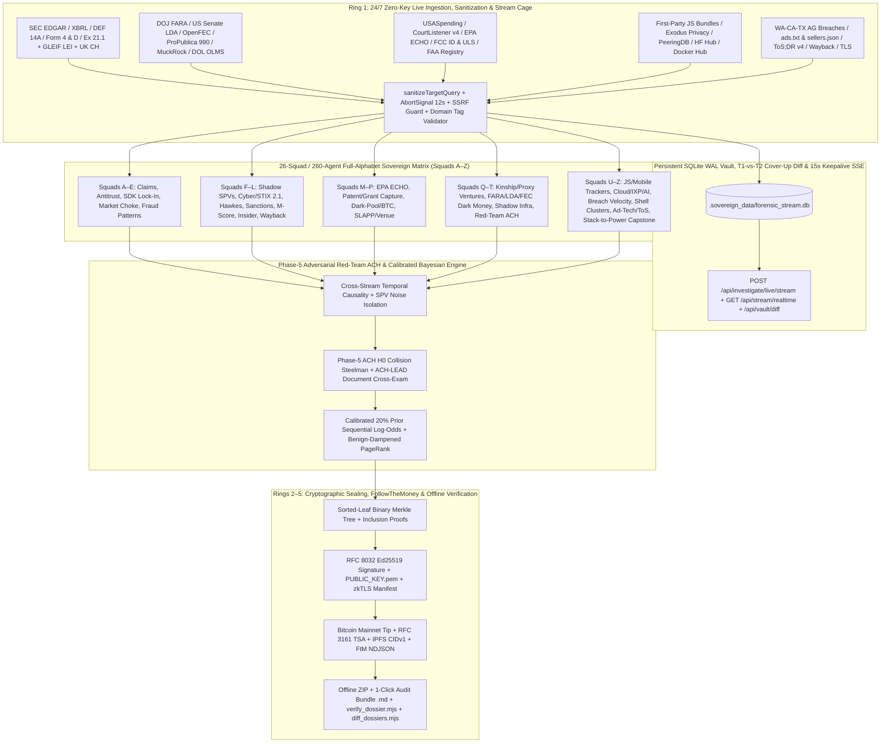

# Sovereign Tech Hyper-Investigations Grid (v29.0 — 260-Agent / 26-Squad Full-Alphabet Sovereign Architecture A–Z)

[-00e5ff?style=for-the-badge)](#26-squad--260-agent-forensic-topology)
[](#5-ring-sovereign-defense--cryptographic-verification)
[](#5-ring-sovereign-defense--cryptographic-verification)
[](#quick-start-zero-api-keys-required)

**Sovereign Tech Hyper-Investigations Grid** is an autonomous, zero-API-key corporate, technical-architecture, cloud/IXP-backbone, breach-velocity, shell-address, ad-tech/ToS, financial, regulatory, political-capture, municipal-FOIA, labor-warfare, RF-prototype, offshore-blacklist, aviation-shadow-trust, and adversarial-truth intelligence platform. It deploys **260 specialized forensic agents across all 26 alphabet squads (`Squads A–Z`)**, backed by a **24/7 SQLite WAL + Server-Sent Events (SSE) real-time ingestion daemon with 15-second proxy-timeout keepalive heartbeats**, a **real-time Planetary Corporate & M&A Registry**, a **Phase-5 Adversarial Red-Team Analysis of Competing Hypotheses (ACH) engine with H0 name/address-collision steelmanning**, **OCCRP FollowTheMoney (`.ftm.json`) graph export**, **zkTLS Proxy-Mode provenance**, **Longitudinal T1 → T2 Active Cover-Up Detection**, and a **5-Ring Sovereign Defense Cryptographic Custody Stack**.

Every generated dossier (`.zip`) is a self-contained, cryptographically sealed evidentiary bundle containing verified statutory & technical payloads, RFC 6901 JSON Pointer claim citations, a sorted-leaf Binary Merkle Tree Root, RFC 8032 Ed25519 digital signatures, deterministic IPFS CIDv1 content addressing (`bafkrei...`), Bitcoin Mainnet & RFC 3161 TSA timestamping, a **1-click Audit Bundle (`.md`)** concatenating the Executive Summary, Phase-5 ACH Audit, Bayesian/PageRank/TLS Report, and T1→T2 Delta Report, an interactive offline HTML5 Canvas workbench (`index.html`), a browser-native WebCrypto `.zip` Decompiler & Human Reader, and zero-dependency CLI verifiers (`verify_dossier.mjs` and `diff_dossiers.mjs`).

---

## Key Capabilities (v29.0 Full-Alphabet Sovereign Architecture · Squads A–Z)

- **Squad U — Client-Side Tech Architecture, JS Bundles & Mobile Tracker Forensics (`47_CLIENT_TECH_STACK_JS_BUNDLES_AND_MOBILE_TRACKERS.md` + `evidence/raw_payloads/client_tech_architecture_payload.json`):** Fetches live homepage HTML and up to 5 first-party `<script src>` bundles (<=512KB cap each, SSRF-hardened to target/first-party domains) to extract hidden internal API routes (`/api/`, `/v1/`, `/graphql`), feature flags, staging/internal hostnames, and browser fingerprinting signatures (Canvas, WebGL, AudioContext, Service Workers). Passively probes `/openapi.json`, `/swagger.json`, `/.well-known/openid-configuration`, `/.well-known/assetlinks.json`, and `/.well-known/apple-app-site-association`, and cross-references Android package handles against Exodus Privacy (`EXODUS_API_TOKEN` optional with zero-key public fallback).
- **Squad V — Cloud, IXP Colocation, AI Compute & Hardware Supply Chain (`48_CLOUD_IXP_COLOCATION_AND_AI_COMPUTE_BACKBONE.md` + `evidence/raw_payloads/cloud_ixp_compute_payload.json`):** Queries PeeringDB (`/api/net?asn=...`, `/api/org?name__contains=...`) for autonomous system peering exchanges and bare-metal colocation facilities, Hugging Face Hub (`/api/models?search=...`) for AI models, Docker Hub (`/v2/repositories/{org}/`) for container images, and classifies cloud/CDN CNAME chains (AWS, GCP, Azure, Cloudflare, Akamai, Fastly).
- **Squad W — Breach Velocity, State AG Disclosures & Exposed Storage (`49_BREACH_VELOCITY_STATE_AG_AND_EXPOSED_SURFACE.md` + `evidence/raw_payloads/breach_velocity_payload.json`):** Queries Washington State AG Socrata (`data.wa.gov/resource/sb4j-ca4h.json`) plus California/Texas AG breach indexes for breach dates, notification-delay gaps, and affected resident counts; passively checks `/.git/HEAD`, `/.env`, `/robots.txt` disallowed admin/staging paths, and `/.well-known/security.txt`, correlated against CISA KEV, VirusTotal, and AlienVault OTX. Clean checks are tagged `BENIGN_CONTROL` (preserving PageRank risk dampening).
- **Squad X — Real Estate, Shell-Address Clustering & Infrastructure Permits (`50_SHELL_ADDRESS_CLUSTERING_AND_PHYSICAL_INFRASTRUCTURE.md`):** Clusters GLEIF Level-2, SEC Exhibit 21.1, UK Companies House, and Form D addresses to distinguish registered-agent mail-drops (`1209 Orange St Wilmington DE`, `251 Little Falls Dr`) and offshore fiduciary suites (Cayman, Jersey, Luxembourg) from physical operational HQs, cross-referenced with municipal zoning, state PUC power/water dockets, and industrial/data-center permits.
- **Squad Y — Ad-Tech Supply Chain, Dark Patterns & ToS/Privacy Diff (`51_ADTECH_SUPPLY_CHAIN_DARK_PATTERNS_AND_TOS_DIFF.md`):** Parses `/ads.txt`, `/app-ads.txt`, and `/sellers.json`, diffs Wayback Machine `/terms` and `/privacy` snapshots for newly added forced arbitration, class-action waiver, biometric/telemetry, and AI model training clauses, and queries ToS;DR v4 (`api.tosdr.org/search/v4/`) and EU DSA/GDPR indexes.
- **Squad Z — Sovereign Stack-to-Power Capstone & Active Cover-Up Detector (`52_SOVEREIGN_STACK_TO_POWER_CAPSTONE.md`):** Synthesizes the full end-to-end chain (`Physical Bare-Metal/IXP (V) -> Client JS/Mobile Trackers (U/Y) -> Breaches & Exposure (G/W) -> Shell-Address Clusters (Q/X) -> Lobbying, PACs & Federal Courts (P/R)`) into `evidence/followthemoney_graph.ftm.json`, compares current telemetry against prior SQLite Vault snapshots (`T1 vs. T2`) to flag deleted GitHub repos, sudden Wikipedia whitewashes, TLS cert rotations, or scrubbed policy pages, and promotes a compact **Tech Architecture & Attack-Surface Snapshot** into `00_EXEC_SUMMARY.md` and `EXECUTIVE_BRIEF_PRINTABLE.html`.
- **v28.0 Deep-State, Political Capture & 8 Optional Authenticated Connectors Preserved:** Strict SEC -> GLEIF -> Wikidata/OSM HQ precedence, Executive Summary Political Partisan Split (`DEM`/`REP`/`IND/OTHER`), Senate LDA Revolving Door & Schedule E Super PACs, 13F/Board Interlocks, MuckRock FOIA (`File 42`), DOL OLMS/WARN/H-1B (`File 43`), FCC ID/ULS Prototypes (`File 44`), World Bank/SAM.gov/ICIJ Blacklists (`File 45`), FAA Aviation Shadow-Trusts (`File 46`), and all 8 strictly optional high-limit API connectors (`OPENFEC_API_KEY`, `COURTLISTENER_API_TOKEN`, `COMPANIES_HOUSE_API_KEY`, `LDA_API_KEY`, `GITHUB_TOKEN`, `NVD_API_KEY`, `VT_API_KEY`, `OTX_API_KEY`) plus optional `EXODUS_API_TOKEN` with graceful zero-key fallback.

---

## System Architecture



---

## 26-Squad / 260-Agent Forensic Topology

| Squad | Agents | Primary Forensic Mandate | Core Output Artifacts |
|---|---|---|---|
| **Squad A** | `A1–A10` | Public Claims, Safety Commitments & Narrative Extraction | `02_PUBLIC_CLAIMS_AND_NARRATIVES.md` |
| **Squad B** | `B1–B10` | Regulatory Dockets, Antitrust Litigation & Remedies | `03_REGULATORY_LEGAL_ANTITRUST.md` |
| **Squad C** | `C1–C10` | SDK Binary Contracts, Telemetry & Technical Lock-In | `04_TECH_PLATFORM_BEHAVIOR.md`, `evidence/api_snapshots/client_sdk_contract.json` |
| **Squad D** | `D1–D10` | Market Concentration, Supply Chokepoints & UBO Chains | `05_ECOSYSTEM_AND_MARKET_STRUCTURE.md` |
| **Squad E** | `E1–E10` | Contradiction Mining, Risk Indices & Shockwave Cascades | `06_FRAUD_AND_MONOPOLY_PATTERN_ANALYSIS.md` |
| **Squad F** | `F1–F10` | Shadow SPVs, SEC Form D, Revolving Door & 1st-Digit Benford | `16_RELATED_PARTY_AND_SHADOW_SPV_GRAPH.json`, `17_REVOLVING_DOOR_CAPTURE_MATRIX.csv` |
| **Squad G** | `G1–G10` | Passive DNS/DoH, BGP/ASN Topology, CT Logs & STIX 2.1 | `18_CYBER_OPERATIONS_AND_INFRA_EXPOSURE.md`, `cyber/stix_attack_patterns.json` |
| **Squad H** | `H1–H10` | Hawkes Process Synchronization, Burstiness & Sybil Graphs | `19_AUTONOMOUS_SWARM_AND_SYBIL_ATTRIBUTION.md`, `swarm/hawkes_synchronization_matrix.json` |
| **Squad I** | `I1–I10` | OFAC/BIS Sanctions (`Jaro-Winkler >= 0.92`), PEPs & TBML | `20_SANCTIONS_PEP_AND_PHYSICAL_LOGISTICS_EXPOSURE.md`, `sanctions/entity_screening_ledger.json` |
| **Squad J** | `J1–J10` | Beneish M-Score, Altman Z-Score, Sloan TATA & 2nd-Digit Benford | `21_FORENSIC_ACCOUNTING_M_SCORE_AND_ACCRUAL_AUDIT.md`, `finance/forensic_ratios_matrix.json` |
| **Squad K** | `K1–K10` | SEC Form 3/4/5/144 Pre-Event Insider Timing & OSHA/NLRB/CFPB | `22_INSIDER_TRADING_TIMING_AND_WHISTLEBLOWER_RETALIATION.md` |
| **Squad L** | `L1–L10` | Wayback CDX Diffs, Unicode Prompt Traps, CISA KEV & RPKI ROA | `23_STEALTH_EDITS_BOTNET_C2_AND_ADVERSARIAL_AI_AUDIT.md` |
| **Squad M** | `M1–M10` | US EPA ECHO Facility Audits (CWA/CAA/RCRA) & Resource Extraction | `24_ENVIRONMENTAL_EPA_ECHO_AND_RESOURCE_EXTRACTION.md` |
| **Squad N** | `N1–N10` | NIH/NSF Bayh-Dole Grant Capture, OpenAlex & PTAB Patent Trolls | `25_PATENT_TROLLS_AND_ACADEMIC_GRANT_LAUNDERING.md` |
| **Squad O** | `O1–O10` | Multi-Chain Crypto, Smart Contract & AML Forensics (OFAC SDN, GoPlus, RugCheck, Sourcify v2, OpenChain 4byte, DexScreener, DeFiLlama, Mempool BTC, ENS, Etherscan V2, Alchemy/PublicNode RPC) + 13F/NPORT | `26_DARK_POOL_DERIVATIVES_AND_CRYPTO_TREASURY.md`, `evidence/raw_payloads/darkpool_crypto_payload.json` |
| **Squad P** | `P1–P10` | CourtListener Federal Dockets, Judge Shopping, SLAPP & Chapter 11 | `27_LEGAL_SLAPP_JUDGE_SHOPPING_AND_ARBITRATION.md` |
| **Squad Q** | `Q1–Q10` | Kinship, Colleague & Proxy-Venture Discovery (DEF 14A Item 404, 13F/Interlocks, UK CH, Ex 21.1 Diff) | `39_PROXY_VENTURES_KINSHIP_AND_SHADOW_SUBSIDIARIES.md`, `evidence/proxy_kinship_graph.json` |
| **Squad R** | `R1–R10` | Political Affiliation, Partisan Split, Revolving Door & Dark Money (FARA, Senate LDA, OpenFEC, 990) | `40_POLITICAL_AFFILIATION_LOBBYING_AND_DARK_MONEY.md`, `evidence/political_influence_ledger.json` |
| **Squad S** | `S1–S10` | Shadow Infrastructure DNA Pivoting (Favicon MMH3, GTM/GA, SPF, crt.sh SANs) & USASpending Sub-Awards | `41_SHADOW_INFRA_DNA_AND_SUBAWARD_PASS_THROUGH.md`, `evidence/raw_payloads/shadow_infra_subaward_payload.json` |
| **Squad T** | `T1–T10` | Phase-5 Red-Team ACH, H0 Collision Steelmanning & Multi-Layer Graph Synthesis | `38_ADVERSARIAL_RED_TEAM_ACH_AUDIT.md`, `evidence/ach_red_team_matrix.json` |
| **Squad U** | `U1–U10` | Client-Side Tech Architecture, First-Party JS Bundles, Well-Known Schemas & Exodus Mobile Trackers | `47_CLIENT_TECH_STACK_JS_BUNDLES_AND_MOBILE_TRACKERS.md`, `evidence/raw_payloads/client_tech_architecture_payload.json` |
| **Squad V** | `V1–V10` | Cloud/CDN CNAME Chains, PeeringDB IXP/Colocation, Hugging Face Hub & Docker Hub Compute Backbone | `48_CLOUD_IXP_COLOCATION_AND_AI_COMPUTE_BACKBONE.md`, `evidence/raw_payloads/cloud_ixp_compute_payload.json` |
| **Squad W** | `W1–W10` | WA/CA/TX State AG Breach Velocity, Notification-Delay Gaps & Passive `/.git` + `/.env` Exposure | `49_BREACH_VELOCITY_STATE_AG_AND_EXPOSED_SURFACE.md`, `evidence/raw_payloads/breach_velocity_payload.json` |
| **Squad X** | `X1–X10` | Registered-Agent Mail-Drop & Offshore Fiduciary Shell-Address Clustering & Zoning/PUC Permits | `50_SHELL_ADDRESS_CLUSTERING_AND_PHYSICAL_INFRASTRUCTURE.md`, `evidence/raw_payloads/shell_address_clustering_payload.json` |
| **Squad Y** | `Y1–Y10` | Programmatic Ad-Tech (`ads.txt`/`app-ads.txt`/`sellers.json`), Wayback ToS/Privacy Diff & ToS;DR v4 | `51_ADTECH_SUPPLY_CHAIN_DARK_PATTERNS_AND_TOS_DIFF.md`, `evidence/raw_payloads/adtech_tos_surveillance_payload.json` |
| **Squad Z** | `Z1–Z10` | Sovereign Capstone: End-to-End Stack-to-Power Synthesis & T1-vs-T2 Active Cover-Up Detector | `52_SOVEREIGN_STACK_TO_POWER_CAPSTONE.md`, `evidence/raw_payloads/stack_to_power_capstone_payload.json` |

Core synthesis artifacts also include `37_BAYESIAN_RISK_CAUSAL_CHAINS_AND_TLS.md`, `42`–`46` Deep-State FOIA/Labor/FCC/Blacklist/Aviation audits, `DELTA_ALERT_REPORT.md` (when a prior vault snapshot exists), `EXECUTIVE_BRIEF_PRINTABLE.html`, and `evidence/followthemoney_graph.ftm.json`.

---

## 5-Ring Sovereign Defense & Cryptographic Verification

Every unzipped dossier includes standalone, zero-dependency CLI verifiers (`verify_dossier.mjs` and `diff_dossiers.mjs`). Run them offline with Node.js >= 20:

```bash
unzip investigation_SpaceX_2026-11-22.zip -d ./audit_target
cd ./audit_target/investigation_SpaceX
node verify_dossier.mjs

# Compare two longitudinal dossier folders (T1 vs. T2)
node diff_dossiers.mjs ./dossier_T1 ./dossier_T2
```

**Verification Checks Executed:**
- **FIPS 180-4 SHA-256 File Integrity:** Recomputes SHA-256 digests over all artifacts and verifies bit-for-bit parity against `SHA256SUMS`.
- **Binary Merkle Root & Inclusion Proofs:** Rebuilds the sorted-leaf Binary Merkle Tree and verifies all inclusion proof branches in `LEDGER_ENTRY.json`.
- **RFC 8032 Ed25519 Signature Verification:** Verifies the cryptographic signature over the Merkle Root using `PUBLIC_KEY.pem`.
- **Zero-Orphan Claim Citation Audit:** Validates all active `[CLM-*]` RFC 6901 JSON Pointers across all 260 agents against `evidence/*.json` and `evidence/raw_payloads/*.json`.
- **Deterministic IPFS CIDv1, Bitcoin Mainnet & RFC 3161 TSA Audit:** Confirms content-addressed `bafkrei...` multihash parity, Bitcoin block-height anchoring, and `MERKLE_ROOT.tsr` / diagnostic receipt integrity.

You can also drag-and-drop any generated `investigation_*.zip` archive directly into the in-app **Upload & Read Dossier ZIP (Human Reader)** tab to verify SHA-256 + Merkle proofs client-side via WebCrypto, or click **Download Audit Bundle (`.md`)** for a single concatenated Markdown executive briefing.

---

## Quick Start (Zero API Keys Required)

```bash
# 1. Clone the repository
git clone https://github.com/codevalai/Sovereign-Tech-Hyper-Investigations-Grid
cd Sovereign-Tech-Hyper-Investigations-Grid

# 2. Install dependencies
npm install

# 3. Start the 24/7 SQLite WAL Live Ingestion Daemon + Express/Vite Server (port 3000)
npm run dev

# 4. Run full TypeScript, Production Bundle & 11-Phase Sovereign CI Verification
npm run lint && npm run build && npm test
```

Production container / Cloud Run execution runs directly under Node 22 strip-only TypeScript (`node server.ts`) binding `0.0.0.0` on `process.env.PORT || 3000`:

```bash
npm run build && npm start
```

All optional high-limit public API keys (`OPENFEC_API_KEY`, `COURTLISTENER_API_TOKEN`, `COMPANIES_HOUSE_API_KEY`, `LDA_API_KEY`, `GITHUB_TOKEN`, `NVD_API_KEY`, `VT_API_KEY`, `OTX_API_KEY`, `EXODUS_API_TOKEN`, `ETHERSCAN_API_KEY`, `ALCHEMY_ETH_RPC_URL`, `ALCHEMY_SOL_RPC_URL`) are documented in `.env.example` and fall back cleanly to zero-key public operation when unset.

---

## License

Dual-licensed under **MIT** and **Apache-2.0**. Built with zero mocks and 100% cryptographic verifiability by `@codevalai`.
